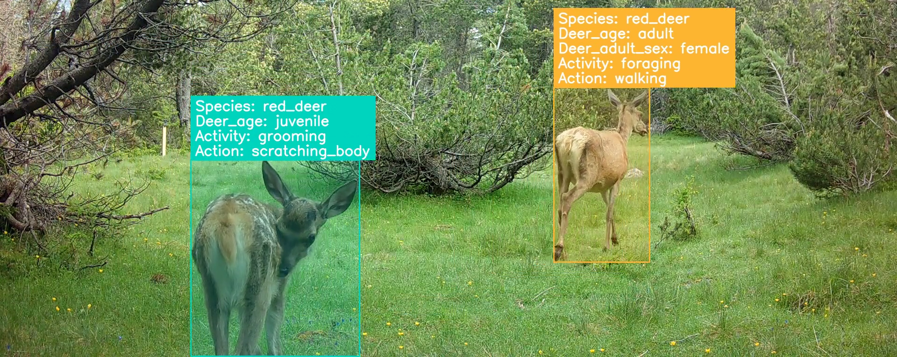

# CT-ViPA - Camera-trap Video Processing and Annotation Pipeline



---

## Overview

CT-ViPA contains a series of scripts to process wildlife observation videos and to densely annotate them at the individual level.
This codebase was developed to create the [MammAlps](https://huggingface.co/datasets/amathislab/Prompting-MammAlps) datasets.

## Documentation

| Document | Description |
|---|---|
| [docs/workflow.md](docs/workflow.md) | Step-by-step pipeline overview, start here to understand or run the pipeline |
| [docs/config.md](docs/config.md) | All configuration parameters explained in detail |
| [docs/database.md](docs/database.md) | Database schema, table descriptions, and how the DB connects pipeline steps |
| [docs/cvat.md](docs/cvat.md) | Guide to upload and download XML files to a CVAT local installation |

---

## Installation

Install the Python environment:

```bash
conda create -n snp_data python=3.10
conda activate snp_data
uv pip install .
```

---

## Quick start
 
1. Copy and edit a config file: `cp configs/default.yaml configs/<my_project>.yaml`
2. Follow the pipeline steps in [docs/workflow.md](docs/workflow.md)


## Repository structure

```
configs/                    # Pipeline configuration files (YAML)
data_processing/            # Pipeline scripts
visualization/              # Annotation visualisation utilities
docs/                       # Documentation
models/                     # IR Detector (custom SVM)
tests/                      # Unit tests (run with `uv run pytest`)
```

## Contributions

The contributors to the original pipeline are: 
- Valentin Gabeff
- Jennifer Shan
- Maël Secretan
- Brendan Flaherty

If you want to add a new contribution to this pipeline, we welcome PRs and GitHub issues.